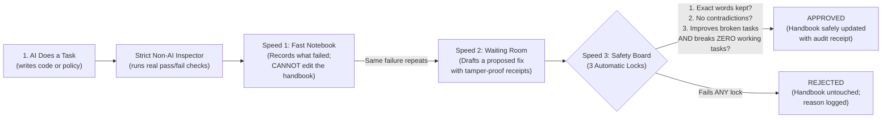

# What Is Axiom? A Plain-English Guide

> **Who this guide is for:** Anyone who wants to understand what Axiom does and why it matters — no coding, database, or AI engineering background required.
>
> *(Looking for the academic paper or engineering deep-dive instead? See [AXIOM-PAPER.md](AXIOM-PAPER.md) for the database study or [AXIOM-V4-HOPE.md](AXIOM-V4-HOPE.md) for the v4 architecture report.)*

---

## 1. The 30-Second Explanation

Imagine hiring a brilliant, ultra-fast assistant who can draft legal contracts, design software, and write company security policies in seconds — **except they wake up with amnesia every morning**.

To help them remember your company's rules, you give them a short cheat sheet ("AI memory") summarizing past mistakes.

Here is the catch we discovered while building Axiom: **when AI systems summarize rules into plain English, they quietly ruin them.** They round numbers, paraphrase exact system names, and accidentally drop critical safeguards — like turning *"require two-factor authentication and cap transfers at \$100,000"* into *"check security and keep transfers reasonable."*

**Axiom is an automated safety and memory-governance engine that sits around any AI model.** It tests the AI's work using strict, non-AI inspectors, prevents important rule details from ever getting watered down, and blocks any memory update that would break something that already works.

---

## 2. The Problem: Why Normal "AI Memory" Quietly Breaks

Most AI tools try to "learn from mistakes" by asking an AI to summarize what went wrong and save that summary as a short tip for next time.

In practice, that creates two hidden failures:

### Failure #1: The Game of Telephone ("Vocabulary Erosion")
Computers and security systems don't understand vibes — they require exact names, exact limits, and exact formats.

When we asked an AI to summarize real security rules into short tips without guardrails:
- On **access-control policies** (banking, healthcare, and admin permissions), unconstrained AI summaries threw away **93.6%** of the exact required identifiers (`73 out of 78`) — and in one real test, literally hallucinated a payout limit **10× too high** (`$1,000,000` instead of `$100,000`)!
- On **web application security code**, unconstrained AI summaries threw away **61.7%** of the exact required identifiers (`29 out of 47`).

The tips *sounded* smart to a human skimming them, yet the AI kept failing real-world checks because the exact details were gone.

### Failure #2: The Overcrowded Sticky Note ("Checklist Displacement")
You can't paste a 500-page manual into every AI request — an AI works best with a short, focused list of top reminders (say, the top 4 rules for the current task).

If you blindly force extra generic reminders onto that sticky note, **something else falls off the bottom**. In our live tests, naively forcing "always-on" reminders actually made AI accuracy **drop by 9 to 22 percentage points** because those generic reminders pushed more urgent task-specific rules off the list!

---

## 3. How Axiom Solves It (The Aviation Safety Board Model)

Instead of trusting an AI to police itself, Axiom wraps any AI model in three plain-sense engineering safeguards:

### Safeguard 1: Never Let the AI Grade Its Own Homework
The AI does the creative work (writing database blueprints, access policies, or web security code). A **completely separate, deterministic inspector** (real database software, a policy simulator, or a sandboxed code runner) grades the result strictly as **PASS** or **FAIL**. No AI opinions, no flattery, no guessing.

### Safeguard 2: The "Word Lock" (Shorten the Prose, Never Drop the Facts)
Before any lesson is saved into Axiom's memory, an automated scanner pulls out every exact field name, numeric limit, status code, and technical header from the official rule. The AI is allowed to make a reminder concise, **but the system automatically rejects the summary if even a single mandatory exact word is missing.**

### Safeguard 3: The Three-Speed Safety System (Axiom-HOPE)
Most "self-improving" AI agents let mistakes immediately rewrite their long-term memory — which causes memory to drift and rot over time. Axiom separates learning into **three strict speeds**, just like an airline's flight recorder, maintenance hangar, and safety board:

1. **Speed 1 — The Fast Notebook (`Fast Clock`):** Watches each task and logs what failed. It is strictly **read-only** with respect to long-term memory — a single bad task can never corrupt the official rules.
2. **Speed 2 — The Waiting Room (`Quarantine Vault`):** When the *same* failure pattern repeats across multiple tasks, Axiom stages a proposed rule improvement in an isolated quarantine folder, stamped with cryptographic fingerprints (SHA-256 receipts) proving exactly which failures triggered it.
3. **Speed 3 — The Safety Board (`Slow Clock`):** Before any waiting-room fix is allowed into the live handbook, it must pass **three automatic locks in sequence**:
   - **Lock 1 (Exact-Word Lock):** Are 100% of required exact terms still intact?
   - **Lock 2 (Consistency Check):** Does this contradict any existing rule or create a circular dependency?
   - **Lock 3 ("Do No Harm" Replay Test):** Axiom replays both the broken tasks *and* a protected set of already-working tasks ("canaries"). The update is approved **only if** it improves the broken tasks **and causes strictly zero regressions** on already-working tasks.

---

## 4. Does It Actually Work? Proof Across 3 Different Domains

To prove Axiom isn't a one-trick pony tied to a single programming language, we tested the exact same unmodified 3-speed governance engine across **three completely different real-world domains**:

| Real-World Domain | What the AI Had to Build | Without Axiom (Normal AI / Loose Summaries) | With Axiom (Exact-Word Lock + 3-Speed Safety Board) | Headline Takeaway |
| :--- | :--- | :---: | :---: | :--- |
| **1. Database Blueprints** *(PostgreSQL — 9 AI models, 8,640 tests)* | Production multi-tenant database tables, security permissions, and audit triggers | Ordinary summaries lost **~20 pp** vs. exact-term memory | **`+20.0 pp`** average accuracy lift across 9 models; **`0`** displaced baseline rules | Locking exact words fixes the "Game of Telephone" across every major AI family. |
| **2. Company Access Rules** *(Banking, Healthcare & Admin — 3 AI models, 270 live tests)* | Who is allowed to approve payouts, read patient records, or rotate encryption keys | No memory: **`0.0%`** full pass Normal summaries: **`3.7%`** full pass | **`70.4%`** full pass (**19× better**) **`95.2%`** individual rule compliance **`0`** regressions | Outperformed naive static checklists by **`+22.2 pp`** full-task pass across all 3 models. |
| **3. Live Web App Security** *(TypeScript APIs — 75 live sandboxed tests)* | Real backend endpoints handling money payouts, admin data exports, and user profiles | No memory: **`0.0%`** full pass (`42.4%` checks) Normal summaries: **`0.0%`** full pass (`71.0%` checks) Naive static checklist: **`0.0%`** (`68.4%` checks) | **`60.0%`** full pass **`91.1%`** individual security checks passed **`0`** regressions | Safety Board caught & blocked 7 harmful/no-op edits — including 1 fix that looked `+10%` better locally but secretly broke 4 admin endpoints! |

### A Real Example of the Safety Board Catching a Sneaky Bug
During our live web-app security test, Axiom proposed a fix that helped **user profile** endpoints by **`+10 percentage points`**. A normal "auto-learning" system would have immediately cheered and deployed that update.

Axiom's Safety Board didn't fall for it. During Lock 3 ("Do No Harm" Replay), it discovered that the exact same rule change silently evicted a cache-security header on **4 separate admin export endpoints** (`TSAPI-006` through `TSAPI-009`). Axiom automatically **rejected** the update, logged the exact evidence in its permanent audit receipt, and instead approved 3 clean refinements that pushed overall compliance from **`0%` to `60%` full pass (`91.1%` rule compliance)** with **zero side effects**.

---

## 5. Why "One-Size-Fits-All" Checklists Don't Work

Different AI models — just like different humans — have different blind spots:
- One AI model might naturally remember tenant privacy checks, but forget exact error formats.
- Another AI model might nail error formats, but accidentally split security rules into separate "OR" blocks that create a loophole.

Because Axiom's Safety Board tests proposed memory updates against *each model's real behavior*, the exact same starting handbook automatically adapts into the safest, highest-performing set of reminders for whichever AI model you plug in — **without anyone manually hand-tuning prompts**.

---

## 6. What Axiom Is — and What It Is NOT

| Axiom **IS** | Axiom **IS NOT** |
| :--- | :--- |
| A **reliability and safety layer** that sits around any AI model (Google Gemini, Gemma, Qwen, Claude, GPT, etc.). | A new chatbot or a replacement LLM trained from scratch. |
| **100% auditable:** Every approved or rejected memory update leaves a permanent cryptographic receipt showing *why* it passed or failed. | A "black box" where the AI silently changes its own instructions behind your back. |
| **Pluggable across industries:** Swap in a new "Domain Cartridge" (databases, access policies, API security, compliance checks) without changing the core safety engine. | Hardcoded to just one programming language or one vendor. |
| **Zero-regression by design:** Refuses to ship a memory update that fixes one problem by breaking something else. | A "move fast and break things" auto-prompting script. |

---

## 7. Plain-English Glossary

If you browse the technical reports or open the Axiom Dashboard, here is what the technical terms mean in everyday language:

- **Deterministic Verifier / Execution Oracle:** A strict, non-AI automated grader (like a real database or code test runner). Given the same input, it always gives the exact same pass/fail verdict.
- **Lexical Identifier Lock ("Word Lock"):** An automatic spell-check for exact technical names, limits, and headers. Ensures summaries never dilute exact rules.
- **Domain Cartridge:** A swappable plug-in module that tells Axiom the rules and automated tests for a specific field (like a game cartridge you pop into a console — e.g., Databases, Access Control, or Web API Security).
- **Fast Clock (`EpisodicRingBuffer`):** The short-term notebook that records recent mistakes without touching the official rulebook.
- **Intermediate Clock (`QuarantineVault`):** The isolated waiting room where repeated failure patterns are turned into candidate fixes with tamper-evident receipts.
- **Slow Clock (`DeepMetaOptimizer`):** The automated 3-lock Safety Board that approves or rejects waiting-room fixes.
- **Canary Replay ("Do No Harm" Test):** Borrowing from "canary in a coal mine" — re-testing already-working tasks before approving any change to guarantee nothing gets broken.
- **SHA-256 Receipt / Digest:** A unique digital fingerprint of the rulebook before and after an update, proving exactly what changed and making tampering impossible to hide.
