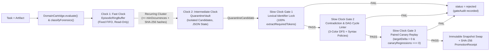

# Axiom-HOPE (Ablation v4): Automated Lexical Locks, 3-Clock Symbolic Governance, and Cross-Domain Generalization

> **Branch:** `feat/v4-axiom-hope` (branched from frozen tag `v3.0-final`, commit `50433cc`)
> **Scope:** Standalone technical report documenting the Axiom-HOPE v4 architecture, unit/integration verification (`321/321` Vitest tests across `34` files), and 3-domain generalization across PostgreSQL 16 DDL (`postgres-v3`), Policy-as-Code ABAC (`policy-abac-v4`, **270 live trials** across 3 models), and Imperative TypeScript API Security Contracts (`ts-api-security-v4`, **75 live trials** on `gemini-3.1-flash-lite`).
> **Data Provenance:** Every metric, contrast, forensic count, and SHA-256 digest in this report is sourced verbatim from `out/v4/policy-abac-cross-model-summary.json`, `out/v4/ts-api-gemini-3-1-flash-lite-summary.json`, `out/v4/*-hope-receipt.json`, `.axiom-state/v4/*.json`, and the deterministic v4 test suite. Frozen v2/v3 checkpoints, vaults, and manuscripts (`docs/AXIOM-PAPER.md`, `docs/AXIOM-V3-PAPER-RESULTS.md`) are untouched.

---

## 1. Executive Summary & Bridge from `v3.0-final`

Confirmatory **Ablation v3** (`v3.0-final`, `9` models × `120` held-out PostgreSQL 16 tasks × `8` conditions = `8,640` single-turn trials) established that **concrete-vocabulary erosion** during unconstrained LLM memory distillation—rather than prose length or rule contradictions—drives the "Distillation Penalty" (`C_ID - C` REML + HKSJ pooled `+20.00 pp`, 95% HKSJ CI `[+16.47, +23.53]`, 95% Prediction Interval `[+10.20, +29.79] pp`; Difference-in-Differences `+18.45 pp`).

However, `v3.0-final` intentionally left three concrete engineering boundaries open:

| v3 Open Boundary | Axiom-HOPE v4 Resolution | Verified Result |
| :--- | :--- | :--- |
| **(a) Hand-curated token map:** v3 relied on a manual `REQUIRED_FACT_TOKENS` dictionary for PostgreSQL. | **Automated Lexical Token Extractor** (`src/v4/lexical-token-extractor.ts`): zero-LLM deterministic extractor capturing quoted/backtick literals, `Namespace::"Name"` entities, `snake_case`, `camelCase`, `SCREAMING_SNAKE_CASE`, multi-segment dotted paths/calls, HTTP headers/directives, template prefixes, SQL/policy clauses, and numeric bounds. | **`77/77` (`100.0%`)** exact recall across all `34` active v3 PostgreSQL rules, **`78/78` (`100.0%`)** across all `12` ABAC rules (vs. `5/78` = `6.4%` in `C`), and **`47/47` (`100.0%`)** across all `12` TypeScript API Security rules (vs. `18/47` = `38.3%` in `C`). |
| **(b) Static Top-$K$ checklist displacement:** v3's feature-weighted Top-10 retrieval displaced universal invariant `F-05` (`created_at`) on `33/33` bound tasks (`499` omissions across the 9-model pool). | **Prerequisite-Aware Retrieval + Slow-Clock Canary Gating** (`src/v4/prerequisite-retriever.ts` + `src/v4/hope/slow-clock.ts`): pulls missing transitive prerequisites into the exact Top-$K$ budget by evicting tail non-prerequisites, and only promotes edges passing zero-regression canary replay. | Reduces PostgreSQL v3 `F-05` displacement from **`33/33` bound tasks (`105/120` total) down to `0/33` (`0/120`)** under exact `K = 10` (`tests/v4-prerequisite-retriever.test.ts`), while live ABAC (`-11.1` to `-22.2 pp` task) and TS-API (`-9.2 pp` fact) trials prove naive static injection degrades tight `K = 4` budgets and must be governed by the Slow Clock. |
| **(c) PostgreSQL-only coupling:** v3's evaluation harness and forensics were tightly coupled to Docker PostgreSQL 16. | **Pluggable `DomainCartridge<TTask, TArtifact>`** (`src/v4/domain-cartridge.ts`): domain-agnostic contract backed by `PostgresV3Cartridge`, `PolicyAbacCartridge` (Cedar-style ABAC), and `TsApiSecurityCartridge` (TypeScript API handlers compiled via `esbuild` and executed inside `node:vm`), sharing the exact same unmodified `src/v4/hope/*`. | **345 live v4 trials across 2 non-SQL domains:** ABAC (`270` trials, `3` models) lifts full-task pass **`3.7%` → `70.4%` (`+66.7 pp`)**; TypeScript API Security (`75` trials) lifts full-task pass **`0.0%` → `60.0%` (`+60.0 pp`)** and mean fact pass **`71.0%` → `91.1%` (`+20.1 pp`)**, beating naive static prereqs by **`+22.7 pp`** facts (`0` canary regressions). |

---

## 2. 3-Clock Symbolic Axiom-HOPE Architecture

Axiom-HOPE decouples online telemetry capture, candidate staging, and canonical memory promotion into **three strictly isolated symbolic clocks** (`src/v4/hope/`). Consistent with **Authority Separation (Invariant 0)**, all three clocks and all verification gates are **100% deterministic (zero LLM calls)**.



### Clock Breakdown

1. **Fast Clock — Task-Scoped Episodic Ring Buffer (`src/v4/hope/fast-clock.ts`)**
   - `EpisodicRingBuffer` maintains a bounded FIFO trace log (`taskId`, `cartridgeId`, `artifactSha256`, `committed`, `failedFacts`, `forensicFlags`, `stderr`, `timestamp`).
   - Every stored trace is deeply frozen (`Object.freeze`). The Fast Clock holds **no mutable reference** to canonical rules or prerequisite graphs, structurally eliminating streaming rewrite erosion.
   - `getRecurringFailureClusters(minOccurrences)` deterministically aggregates recurring `(cartridgeId, factId, triggerFlag)` clusters with deduplicated SHA-256 `evidenceHashes`.

2. **Intermediate Clock — Cryptographic Quarantine Vault (`src/v4/hope/quarantine-vault.ts`)**
   - `QuarantineVault` ingests recurring failure clusters meeting `minOccurrences` (default `3`, configurable to `2` for small sub-cohorts) and stages isolated `QuarantineCandidate` records (`candidateId`, `factId`, `triggerFlag`, `proposedRuleText`, `proposedPrerequisiteEdges`, `evidenceHashes`, `status`, `gateAudit`).
   - Deduplicates repeated flushes idempotently while accumulating unique SHA-256 provenance digests.
   - Serializes deterministically to an isolated v4 path (default `.axiom-state/v4/quarantine-vault.json`) and enforces a runtime path guard refusing writes to any frozen v2/v3 file.

3. **Slow Clock — Deep Meta-Optimizer & 3 Sequential Gates (`src/v4/hope/slow-clock.ts`)**
   - `DeepMetaOptimizer.evaluateCandidate()` evaluates each staged candidate sequentially (fail-fast) through three zero-LLM deterministic gates:
     1. **Gate 1 — Automated Lexical Identifier Lock (`evaluateLexicalIdentifierLock`):** Runs `extractRequiredTokens()` on the canonical rule and verifies `100%` boundary-aware retention of every concrete operational token inside `proposedRuleText`.
     2. **Gate 2 — Cross-Rule Contradiction & DAG Cycle Linter (`evaluateCrossRuleContradictions`):** Rejects inline/unnamed `REFERENCES` conflicts, duplicate `PRIMARY KEY` prescriptions, client-mutable `user_metadata` auth leaks, `F-19` missing positive `GRANT`s, and any circular prerequisite dependency (detected via deterministic 3-color DFS on the merged `PrerequisiteGraph`).
     3. **Gate 3 — Paired Canary Replay Gate:** Evaluates `beforeSnapshot` vs. `afterSnapshot` across `targetTasks` and frozen `canaryTasks` via an injectable deterministic `PairedCanaryEvaluator`. Approves promotion **strictly iff** `targetCohortDelta > 0 && canaryRegressions === 0`.
   - On `'approved'`, returns a brand-new deeply frozen `HopeMemorySnapshot` (`{ rules, prerequisiteGraph }`) and an immutable `PromotionReceipt` recording canonical `beforeSha256` and `afterSha256` digests without mutating inputs in place.

4. **Domain-Agnostic Orchestrator (`src/v4/hope/hope-engine.ts`)**
   - `AxiomHopeEngine<TTask, TArtifact>` wires `FastClock → QuarantineVault → SlowClock` for any `DomainCartridge<TTask, TArtifact>` via `recordTrial()`, `flushToQuarantine()`, `runSlowClockPromotion()`, and `retrieveRules()`. Zero modifications to `src/v4/hope/*` were needed to onboard `PolicyAbacCartridge`.

---

## 3. Cross-Domain Empirical Proof — Policy-as-Code ABAC (270 Live Trials)

### 3.1 Domain Setup & Frozen Distillation Vaults

- **Cartridge:** `PolicyAbacCartridge` (`src/v4/cartridges/policy-abac-cartridge.ts`) — `12` canonical Cedar-style ABAC authorization invariants (`P-01`..`P-12`) covering multi-tenant isolation (`principal.tenant_id == resource.tenant_id`), explicit `forbid` precedence for suspended accounts (`principal.is_suspended == true`) and service accounts (`principal.is_service_account == true`), locked-resource guards (`resource.is_locked == true`), MFA verification (`context.mfa_verified == true`), separation of duties (`principal.id != resource.created_by`), payout limits (`Action::"approve_payout"`, `Resource::"LedgerEntry"`, `resource.amount_cents <= 10000000`), fresh sessions (`context.session_age_seconds <= 900`), network/risk ceilings, healthcare PHI consent & break-glass tickets, and audit-export clearance.
- **Held-Out Tasks:** `18` deterministic tasks (`fixtures/v4/policy-abac-tasks.json`, `6` banking/payouts, `6` healthcare PHI/break-glass, `6` multi-tenant audit/KMS admin), graded by a zero-LLM Cedar recursive-descent parser and explicit-`forbid`-overrides-`permit` execution oracle over paired `ALLOW`/`DENY` test vectors.
- **Distillation Vaults (built once via `gemini-3.1-flash-lite` at `temperature = 0` and frozen for all 3 models):**
  - **Unconstrained Prose Vault (`C`, `.axiom-state/v4/policy-abac-c.json`):** Retained only **`5/78` (`6.4%`)** required operational tokens (`0/12` rules at `100%`), including an authentic 10× threshold hallucination on `P-06` (`100,000,000 cents` instead of `10000000` cents) and complete erasure of `context.mfa_verified`, `principal.is_suspended`, and `resource.created_by`.
  - **Automated Lexical-Locked Vault (`C_ID_auto`, `.axiom-state/v4/policy-abac-cid-auto.json`):** Gated automatically by `extractRequiredTokens()` — retained **`78/78` (`100.0%`)** required operational tokens (`12/12` rules passed Gate 1 on attempt `1`).
- **5 Experimental Arms (`K = 4` retrieval budget, `temperature = 0`, unsupervised TF-IDF prompt ranking with zero access to `boundFacts`):**
  1. `A` — Zero-Shot (Cedar grammar only, no memory lessons)
  2. `C` — Top-4 unconstrained distilled lessons (`policy-abac-c.json`)
  3. `C_ID_prereq` — Top-4 lexical-locked lessons + naive static prerequisite injection (`-> P-01`, `-> P-02`)
  4. `C_ID_auto` — Top-4 lexical-locked distilled lessons (`policy-abac-cid-auto.json`, exact same rule IDs as `C`)
  5. `C_ID_hope` — Top-4 lexical-locked lessons governed by the model's Slow-Clock-promoted `{ rules, prerequisiteGraph }` snapshot

### 3.2 Full-Task Pass Rate Across 3 Models (`270` Live Trials)

| Model | Provider | Trials | `A` | `C` | `C_ID_prereq` | `C_ID_auto` | `C_ID_hope` | `C_ID_auto - C` | `C_ID_hope - C` | `C_ID_hope - C_ID_prereq` |
| :--- | :--- | :---: | :---: | :---: | :---: | :---: | :---: | :---: | :---: | :---: |
| `gemini-3.1-flash-lite` | Google AI Studio | `90/90` | `0.0%` (`0/18`) | `11.1%` (`2/18`) | `55.6%` (`10/18`) | `66.7%` (`12/18`) | **`72.2%` (`13/18`)** | `+55.6 pp` | **`+61.1 pp`** | **`+16.7 pp`** |
| `gemma-4-31b-it` | Google AI Studio | `90/90` | `0.0%` (`0/18`) | `0.0%` (`0/18`) | `38.9%` (`7/18`) | `61.1%` (`11/18`) | **`61.1%` (`11/18`)** | `+61.1 pp` | **`+61.1 pp`** | **`+22.2 pp`** |
| `qwen/qwen3.8-27b` | Groq | `90/90` | `0.0%` (`0/18`) | `0.0%` (`0/18`) | `50.0%` (`9/18`) | `72.2%` (`13/18`) | **`77.8%` (`14/18`)** | `+72.2 pp` | **`+77.8 pp`** | **`+27.8 pp`** |
| **Pooled Mean (`n = 3`)** | **Multi-Provider** | **`270/270`** | **`0.0%`** | **`3.7%`** | **`48.1%`** | **`66.7%`** | **`70.4%`** | **`+63.0 pp`** | **`+66.7 pp`** | **`+22.2 pp`** |

### 3.3 Mean Bound-Fact Pass Rate Across 3 Models

| Model | `A` | `C` | `C_ID_prereq` | `C_ID_auto` | `C_ID_hope` | `C_ID_auto - C` | `C_ID_hope - C` | `C_ID_hope - C_ID_auto` | `C_ID_hope - C_ID_prereq` |
| :--- | :---: | :---: | :---: | :---: | :---: | :---: | :---: | :---: | :---: |
| `gemini-3.1-flash-lite` | `57.2%` | `76.8%` | `92.2%` | `91.2%` | **`95.5%`** | `+14.4 pp` | **`+18.8 pp`** | `+4.4 pp` | **`+3.3 pp`** |
| `gemma-4-31b-it` | `61.9%` | `60.4%` | `85.0%` | `92.8%` | **`93.5%`** | `+32.5 pp` | **`+33.1 pp`** | `+0.7 pp` | **`+8.5 pp`** |
| `qwen/qwen3.8-27b` | `30.4%` | `60.3%` | `91.3%` | `94.9%` | **`96.5%`** | `+34.5 pp` | **`+36.2 pp`** | `+1.6 pp` | **`+5.2 pp`** |
| **Pooled Mean (`n = 3`)** | **`49.8%`** | **`65.8%`** | **`89.5%`** | **`92.9%`** | **`95.2%`** | **`+27.1 pp`** | **`+29.4 pp`** | **`+2.2 pp`** | **`+5.7 pp`** |

*(Commit rates under `C_ID_hope` were `18/18` = `100.0%` on all 3 models; `missingForbidSuspended`, `missingMfaRequirement`, `paraphrasedMfaClaim`, `missingServiceAccountForbid`, and `syntaxError` dropped to `0/18` on all 3 models under `C_ID_hope`.)*

### 3.4 Key Scientific Finding: Model-Adaptive Symbolic Governance

The 3-model replication surfaces two findings that static memory heuristics cannot achieve:

1. **Unconditional Static Prerequisites Hurt Under Tight Budgets (`Q-STATIC-P-01` Rejected `3/3` Times):**
   Because all three models already synthesize `principal.tenant_id == resource.tenant_id` (`P-01`) reliably without prompting (`0/18` `missingTenantIsolation` in Arm `A` on Gemini and Qwen; `3/18` on Gemma), naively forcing `-> P-01` into a `K = 4` prompt (`C_ID_prereq`) evicted high-value non-obvious rules (`P-04` MFA, `P-08` risk/IP, `P-07` session age). As a result, `C_ID_prereq` **degraded** full-task pass relative to `C_ID_auto` on every model (`-11.1 pp` on Gemini, `-22.2 pp` on Gemma, `-22.2 pp` on Qwen). Axiom-HOPE's Slow Clock Paired Canary Replay Gate caught and **rejected `Q-STATIC-P-01` on 3/3 models** (`3`, `4`, and `4` canary regressions blocked).

2. **Model-Adaptive Promotion Branches Automatically from the Same Frozen Rules:**
   Starting from the exact same canonical snapshot (`79e805a90416...`), each model converged to a **different optimal zero-regression governance snapshot** tailored to its own empirical failure profile:
   - **`Q-P-06-P-02` (`P-06 -> P-02`)** passed all 3 gates on **3/3 models** (`+12.5 pp` on `ABAC-004`, `0` canary regressions), lifting `P-02` retrieval from `17/18` to `18/18` and eliminating `missingForbidSuspended` to `0/18` across all three models.
   - **`Q-P-12-P-07` (`P-12 -> [P-02, P-07]`)** fixed `ABAC-017` (`5/6 → 6/6`) on both Gemini and Qwen, **but** behaved differently on perturbed canary `ABAC-010` (a healthcare break-glass task where `P-12` sat in slot #4): on **`gemini-3.1-flash-lite`**, injecting `P-07` caused `ABAC-010` to fail (`1` canary regression → **REJECTED**); on **`gemma-4-31b-it`**, it produced `0.0 pp` target gain (**REJECTED**); on **`qwen/qwen3.8-27b`**, Qwen scoped `P-07` cleanly without breaking `ABAC-010` (`+8.3 pp` target gain, **`0` canary regressions → APPROVED & PROMOTED**), lifting Qwen's `C_ID_hope` to **`77.8%` (`14/18`)**!
   - **`Q-P-06-CONJUNCT`** (lexical-locked `P-06` rule clarification against split OR-ed `permit` blocks) fixed Gemini's split-`permit` bug on `ABAC-002` (`2/6 → 6/6`, `+22.2 pp`, `0` regressions → **APPROVED & PROMOTED** on Gemini, lifting Gemini to **`72.2%` (`13/18`)**), while being cleanly **REJECTED** as vacuous (`0.0 pp`) on Gemma and Qwen (which did not exhibit split-`permit` failures).

---

## 4. Immutable Slow Clock Governance Ledger

### 4.1 Per-Model Snapshot Provenance & Promoted State

All 3 runs started from the identical canonical initial snapshot (`initialSnapshotSha256 = 79e805a9041663c17593900c231e2e46c1fcb7a8bcae577fa74cd642cd09ef69`), transitioned identically through `dd861453c554...` upon approving `Q-P-06-P-02`, and branched deterministically into model-specific final snapshots:

| Model | Receipt File | Initial Snapshot SHA-256 | Final Snapshot SHA-256 | Promoted Graph | Updated Rules | Protected Canaries |
| :--- | :--- | :--- | :--- | :--- | :---: | :---: |
| `gemini-3.1-flash-lite` | `out/v4/policy-abac-hope-receipt.json` | `79e805a90416...ef69` | `3d4dc52fd48d...b738` | `P-06 -> [P-02]` | `P-06` | `12` |
| `gemma-4-31b-it` | `out/v4/policy-abac-gemma-4-31b-it-hope-receipt.json` | `79e805a90416...ef69` | `dd861453c554...9357` | `P-06 -> [P-02]` | *(none)* | `11` |
| `qwen/qwen3.8-27b` | `out/v4/policy-abac-qwen-qwen3-8-27b-hope-receipt.json` | `79e805a90416...ef69` | `dc6605f51fef...8dfd` | `P-06 -> [P-02]`, `P-12 -> [P-02, P-07]` | *(none)* | `13` |

*(Full 64-char final SHA-256 digests: Gemini `3d4dc52fd48d6f1908fb846217831a395e5cb9fe52cef1bc1aad070fb3f3b738`, Gemma `dd861453c5549470a599681aa7620e322d81a2922e6f6d1aec0f29c92d149357`, Qwen `dc6605f51fef6f4d23f4f1e08a3d3f515104e48431eb5dab801871825b938dfd`.)*

### 4.2 Complete Candidate Accept / Reject Ledger (`15` Slow Clock Audits)

| Model | Candidate ID | Proposed Patch | Gates 1 & 2 | Target Delta (Full Pass) | Canary Regressions | Decision | Snapshot Transition |
| :--- | :--- | :--- | :---: | :---: | :--- | :---: | :--- |
| `gemini-3.1-flash-lite` | `Q-STATIC-P-01` | Naive static `-> P-01, P-02` | PASS | `+13.2 pp` (`0→1/6`) | `3` (`ABAC-001, 014, 016`) | **REJECTED** | — |
| `gemini-3.1-flash-lite` | `Q-P-06-P-02` | Edge `P-06 -> P-02` | PASS | `+12.5 pp` (`0→0/1`, `6→7/8`) | `0` | **APPROVED** | `79e805a90416 → dd861453c554` |
| `gemini-3.1-flash-lite` | `Q-P-12-P-07` | Edges `P-12 -> [P-02, P-07]` | PASS | `+8.3 pp` (`0→1/2`) | `1` (`ABAC-010`) | **REJECTED** | — |
| `gemini-3.1-flash-lite` | `Q-P-06-CONJUNCT` | `P-06` lexical-locked `&&` rule | PASS | `+22.2 pp` (`0→1/3`) | `0` | **APPROVED** | `dd861453c554 → 3d4dc52fd48d` |
| `gemma-4-31b-it` | `Q-STATIC-P-01` | Naive static `-> P-01, P-02` | PASS | `-9.6 pp` (`0→0/7`) | `4` (`ABAC-002, 003, 014, 016`) | **REJECTED** | — |
| `gemma-4-31b-it` | `Q-P-06-P-02` | Edge `P-06 -> P-02` | PASS | `+12.5 pp` (`0→0/1`, `6→7/8`) | `0` | **APPROVED** | `79e805a90416 → dd861453c554` |
| `gemma-4-31b-it` | `Q-P-06-P-01` | Edge `P-06 -> P-01` | PASS | `+0.0 pp` (`0→0/2`) | `2` (`ABAC-002, 003`) | **REJECTED** | — |
| `gemma-4-31b-it` | `Q-P-12-P-07` | Edges `P-12 -> [P-02, P-07]` | PASS | `+0.0 pp` (`0→0/2`) | `0` | **REJECTED** | — |
| `gemma-4-31b-it` | `Q-P-06-CONJUNCT` | `P-06` lexical-locked `&&` rule | PASS | `+0.0 pp` (`0→0/3`) | `0` | **REJECTED** | — |
| `gemma-4-31b-it` | `Q-P-12-FRESH` | `P-12` lexical-locked session rule | PASS | `+0.0 pp` (`0→0/2`) | `0` | **REJECTED** | — |
| `qwen/qwen3.8-27b` | `Q-STATIC-P-01` | Naive static `-> P-01, P-02` | PASS | `+2.5 pp` (`0→0/5`) | `4` (`ABAC-001, 006, 014, 016`) | **REJECTED** | — |
| `qwen/qwen3.8-27b` | `Q-P-06-P-02` | Edge `P-06 -> P-02` | PASS | `+12.5 pp` (`0→0/1`, `6→7/8`) | `0` | **APPROVED** | `79e805a90416 → dd861453c554` |
| `qwen/qwen3.8-27b` | `Q-P-12-P-07` | Edges `P-12 -> [P-02, P-07]` | PASS | `+8.3 pp` (`0→1/2`) | `0` | **APPROVED** | `dd861453c554 → dc6605f51fef` |
| `qwen/qwen3.8-27b` | `Q-P-06-CONJUNCT` | `P-06` lexical-locked `&&` rule | PASS | `+0.0 pp` (`0→0/2`) | `0` | **REJECTED** | — |
| `qwen/qwen3.8-27b` | `Q-P-12-FRESH` | `P-12` lexical-locked session rule | PASS | `+0.0 pp` (`1→1/2`) | `0` | **REJECTED** | — |

### 4.3 Frozen v4 Input Provenance

| Artifact | Path | SHA-256 |
| :--- | :--- | :--- |
| Held-out ABAC Task Corpus (`18` tasks) | `fixtures/v4/policy-abac-tasks.json` | `4500a63f74ed402e81cc83be4d361101e9024bc03ac9e5366c21baba658fb4fb` |
| Unconstrained Distillation Vault (`C`, `5/78` tokens) | `.axiom-state/v4/policy-abac-c.json` | `76689d0e40cdf094add47228430bf6f6c37a8d4e911db4bbc004837145708109` |
| Automated Lexical-Locked Vault (`C_ID_auto`, `78/78` tokens) | `.axiom-state/v4/policy-abac-cid-auto.json` | `cee4937e5dcd2467172d4a71e6a329e4d6046eb74625a268dd78c395de5a217a` |

---

## 5. Domain 3 — Imperative TypeScript API Security Contracts (`TsApiSecurityCartridge`, 75 Live Trials)

To prove that unmodified `src/v4/hope/*` governs **imperative application code** — not only declarative SQL DDL or Cedar authorization policies — we onboarded a 3rd `DomainCartridge`: **`TsApiSecurityCartridge`** (`src/v4/cartridges/ts-api-security-cartridge.ts`, `id: 'ts-api-security-v4'`), with **zero modifications to `src/v4/hope/*`**.

### 5.1 Domain Setup & Frozen Distillation Vaults

- **Cartridge & Deterministic Execution Oracle:** `12` canonical API security contracts (`TS-01`..`TS-12`) covering tenant isolation (`session.tenantId !== payload.tenantId` → `403`), `safeParse` request body validation (`400`, never unchecked `req.json()`), active session auth (`401`), standardized nested error envelopes (`{ error: { code, message, requestId } }`), explicit role allowlist (`ALLOWED_ROLES.includes(session.role)`), zero secret leakage (`SUPABASE_SERVICE_ROLE_KEY`, `process.env.PRIVATE_KEY`, `passwordHash`), `x-idempotency-key` header enforcement (`400`), `Cache-Control: no-store` on both success and error responses, `emitAuditEvent` (`actorId`, `requestId`), payout bounds (`amountCents > 0`, `<= 10000000`), admin export projection (`exportFields`, `limit <= 500`), and profile ownership + mass-assignment guards (`session.userId === payload.targetUserId` / `tenant_admin`).
- **Held-Out Task Corpus (`15` endpoints):** `fixtures/v4/ts-api-security-tasks.json` (`TSAPI-001`..`TSAPI-015`: `5` financial payouts, `5` multi-tenant admin exports, `5` user profile mutations). Every generated TypeScript route handler is compiled strictly via `esbuild.transformSync` + `vm.Script`, statically inspected via comment-stripped AST checks, and executed live inside an isolated `node:vm` sandbox (allowing only `zod`, blocking host imports such as `node:fs`) against bound security test vectors (`valid`, `cross_tenant`, `unauthenticated`, `malformed_payload`, `unauthorized_role`, `missing_idempotency_key`, `out_of_bounds_amount`, `excessive_export_limit`, `cross_user_mutation`, `mass_assignment`).
- **Frozen Distillation Vaults (built once via `gemini-3.1-flash-lite`, `temperature = 0`):**
  - **Unconstrained Prose Vault (`C`, `.axiom-state/v4/ts-api-c.json`):** Retained only **`18/47` (`38.3%`)** required operational tokens (`4/12` rules at `100%`), dropping `ALLOWED_ROLES.includes(session.role)`, `session.tenantId`, `payload.tenantId`, `SUPABASE_SERVICE_ROLE_KEY`, `process.env.PRIVATE_KEY`, `passwordHash`, `exportFields`, `<= 500`, and `payload.targetUserId`.
  - **Automated Lexical-Locked Vault (`C_ID_auto`, `.axiom-state/v4/ts-api-cid-auto.json`):** Gated automatically by `extractRequiredTokens()` — retained **`47/47` (`100.0%`)** required tokens (`12/12` rules passed Gate 1 on attempt `1`, while maintaining `77/77` PostgreSQL and `78/78` ABAC token parity).

### 5.2 5-Arm Live Results (`gemini-3.1-flash-lite`, `K = 4`, `temperature = 0`, `75` Trials)

| Arm | Full-Task Pass | Mean Fact Pass | Committed (`esbuild` + `vm`) | `TS-01` Ret | `TS-04` Ret | `TS-08` Ret | `missingErrorEnvelope` | `missingTenantCheck` |
| :--- | :---: | :---: | :---: | :---: | :---: | :---: | :---: | :---: |
| `A` (Zero-Shot) | `0/15 (0.0%)` | `42.4%` | `15/15 (100.0%)` | `0/15` | `0/15` | `0/15` | `15` | `4` |
| `C` (Unconstrained) | `0/15 (0.0%)` | `71.0%` | `15/15 (100.0%)` | `11/15` | `0/15` | `15/15` | `15` | `0` |
| `C_ID_prereq` (Naive Static) | `0/15 (0.0%)` | `68.4%` | `15/15 (100.0%)` | `14/15` | `10/15` | `1/15` | `10` | `1` |
| `C_ID_auto` (Lexical Lock) | `0/15 (0.0%)` | `77.6%` | `15/15 (100.0%)` | `11/15` | `0/15` | `15/15` | `15` | `1` |
| **`C_ID_hope` (3-Clock HOPE)** | **`9/15 (60.0%)`** | **`91.1%`** | **`15/15 (100.0%)`** | `11/15` | `0/15` | `15/15` | **`5`** | **`0`** |

**Causal Contrasts (`out/v4/ts-api-gemini-3-1-flash-lite-summary.json`):**
- `C_ID_auto - C` (Automated Lexical Identifier Lock): `+0.0 pp` full-task / **`+6.6 pp`** mean fact (`77.6%` vs. `71.0%`).
- `C_ID_prereq - C_ID_auto` (Naive Static Prerequisite Prior at `K = 4`): `+0.0 pp` full-task / **`-9.2 pp`** mean fact (static prerequisites evicted `TS-08` from `15/15` down to `1/15`).
- **`C_ID_hope - C`:** **`+60.0 pp`** full-task / **`+20.1 pp`** mean fact (`91.1%` vs. `71.0%`).
- **`C_ID_hope - C_ID_auto`:** **`+60.0 pp`** full-task / **`+13.5 pp`** mean fact (`91.1%` vs. `77.6%`).
- **`C_ID_hope - C_ID_prereq`:** **`+60.0 pp`** full-task / **`+22.7 pp`** mean fact (`91.1%` vs. `68.4%`).
- **`C_ID_hope - A`:** **`+60.0 pp`** full-task / **`+48.7 pp`** mean fact (`91.1%` vs. `42.4%`).

### 5.3 Immutable Slow Clock Governance Ledger (`out/v4/ts-api-hope-receipt.json`, `10` Audits)

- **Snapshot SHA-256 Transition:** `a2651fa4f2e56c2ca364e158153f318cc2a07c42f1d1b6eb6638d037d663afe9` → `5a7eb2214f46344e0d1713f4d5977165ce6939e0cfd40889800846d5dca27bfb`
- **Promoted State:** `promotedPrerequisiteGraph = {}` (all static and regressing edges rejected), `updatedRuleStatements = [TS-05, TS-11, TS-12]` (`0` canary regressions).

| Candidate ID | Proposed Patch | Gates 1 & 2 | Target Score Delta (Full Pass) | Canary Regressions | Decision | Snapshot Transition |
| :--- | :--- | :---: | :---: | :--- | :---: | :--- |
| `Q-STATIC-TS-PREREQ` | Full static `DEFAULT_TS_API_SECURITY_PREREQUISITE_GRAPH` | PASS | `-9.20 pp` (`0→0/15`) | `0` | **REJECTED** | — |
| `Q-EDGE-TS-10-TS-04` | Edge `TS-10 -> TS-04` | PASS | `-10.00 pp` (`0→0/5`) | `0` | **REJECTED** | — |
| `Q-EDGE-TS-10-TS-05` | Edge `TS-10 -> TS-05` | PASS | `-4.00 pp` (`0→0/5`) | `0` | **REJECTED** | — |
| `Q-EDGE-TS-11-TS-04` | Edge `TS-11 -> TS-04` | PASS | `-22.22 pp` (`0→0/5`) | `0` | **REJECTED** | — |
| **`Q-EDGE-TS-12-TS-04`** | **Edge `TS-12 -> TS-04`** | PASS | **`+10.00 pp`** (`0→0/5`) | **`4`** (`TSAPI-006, 007, 008, 009`) | **REJECTED** | — |
| `Q-REFINE-TS-04` | `TS-04` nested error envelope refinement | PASS | `0.00 pp` (`0→0/15`) | `0` | **REJECTED** | — |
| **`Q-REFINE-TS-12`** | `TS-12` `.strict()` + envelope + `no-store` refinement | PASS | **`+22.50 pp`** (`0→4/5`) | **`0`** | **APPROVED** | `a2651fa4f2e5 → d21aca54a646` |
| **`Q-REFINE-TS-05`** | `TS-05` exact uppercase `const ALLOWED_ROLES` refinement | PASS | **`+8.33 pp`** (`0→2/4`) | **`0`** | **APPROVED** | `d21aca54a646 → 5baa9b921f23` |
| `Q-ANCHOR-TS-10` | `TS-10` payout anchor refinement | PASS | `-2.00 pp` (`0→1/5`) | `0` | **REJECTED** | — |
| **`Q-ANCHOR-TS-11`** | `TS-11` admin export anchor refinement | PASS | `+0.00 pp` (`+1.78e-16`; **`2→4/5`**) | **`0`** | **APPROVED** | `5baa9b921f23 → 5a7eb2214f46` |

> **Cross-Domain Canary Protection Highlight:** `Q-EDGE-TS-12-TS-04` produced a genuine **`+10.00 pp`** improvement on profile mutation targets (`TSAPI-011..015`), yet Gate 3 automatically **REJECTED** it because `TS-12` also ranked in the Top-4 of admin export endpoints (`TSAPI-006..009`), where injecting `TS-04` evicted `TS-08` (`Cache-Control: no-store`) and triggered **4 cross-domain canary regressions**. Instead, Slow Clock promoted three zero-regression lexical-locked rule refinements (`TS-12`, `TS-05`, `TS-11`) that lifted `C_ID_hope` to **`9/15` (`60.0%`) full-task pass (`5/5` profiles, `4/5` admin exports) and `91.1%` mean fact compliance**.

### 5.4 Frozen TS-API Input Provenance

| Artifact | Path | SHA-256 |
| :--- | :--- | :--- |
| Held-out TS-API Task Corpus (`15` tasks) | `fixtures/v4/ts-api-security-tasks.json` | `8551df62384d8a0f6ad304d9d88890ece655f3f5fe3d20d9b5a52ab454fc2745` |
| Unconstrained Distillation Vault (`C`, `18/47` tokens) | `.axiom-state/v4/ts-api-c.json` | `5865190105823899548173c8e4eaf2860cc68b91c7e82b1de48e1e2aebd84c70` |
| Automated Lexical-Locked Vault (`C_ID_auto`, `47/47` tokens) | `.axiom-state/v4/ts-api-cid-auto.json` | `605c43d91f1f621931cd300a9eadcb26a0669b2248eff8f4c328ded25a387838` |

---

## 6. Reproducibility & Verification Commands

All offline unit/integration checks run at `$0` API cost without Docker or external network access:

```bash
# 1. Strict TypeScript check & full Vitest test suite (34 files, 321/321 tests)
npx tsc --noEmit
npm test

# 2. Run v4-only unit & integration tests (lexical recall, prereq retrieval, 3 cartridges, 3-clock HOPE)
npx vitest run tests/v4-lexical-extractor.test.ts tests/v4-prerequisite-retriever.test.ts tests/v4-domain-cartridge.test.ts tests/v4-hope-engine.test.ts tests/v4-policy-abac-cartridge.test.ts tests/v4-ts-api-security-cartridge.test.ts
```

To reproduce or extend the live Policy-as-Code ABAC and TypeScript API Security replications (requires `GEMINI_API_KEY` and/or `GROQ_API_KEY` in `.env`):

```bash
# 3. Build frozen unconstrained (C) and lexical-locked (C_ID_auto) Policy-as-Code & TS-API vaults
npx tsx scripts/v4/build-policy-abac-vaults.ts --model gemini-3.1-flash-lite
npx tsx scripts/v4/build-ts-api-vaults.ts --model gemini-3.1-flash-lite

# 4. Run 4-arm ABAC pilots (A, C, C_ID_auto, C_ID_prereq; 72 calls/model, resumable)
npx tsx scripts/v4/run-policy-abac-pilot.ts --model gemini-3.1-flash-lite --provider gemini --top-k 4
npx tsx scripts/v4/run-policy-abac-pilot.ts --model gemma-4-31b-it --provider gemini --top-k 4 --delay-ms 1200
npx tsx scripts/v4/run-policy-abac-pilot.ts --model qwen/qwen3.8-27b --provider groq --top-k 4 --delay-ms 1500

# 5. Execute 3-clock Slow Clock ABAC governance loop & evaluate promoted C_ID_hope arm (18 calls/model)
npx tsx scripts/v4/run-policy-abac-hope-loop.ts --model gemini-3.1-flash-lite --provider gemini --top-k 4
npx tsx scripts/v4/run-policy-abac-hope-loop.ts --model gemma-4-31b-it --provider gemini --top-k 4 --delay-ms 1200
npx tsx scripts/v4/run-policy-abac-hope-loop.ts --model qwen/qwen3.8-27b --provider groq --top-k 4 --delay-ms 1500

# 6. Run 4-arm TS-API pilot (60 calls) + live 3-clock HOPE governance loop (15 calls)
npx tsx scripts/v4/run-ts-api-pilot.ts --model gemini-3.1-flash-lite --provider gemini --top-k 4 --delay-ms 4200
npx tsx scripts/v4/run-ts-api-hope-loop.ts --model gemini-3.1-flash-lite --provider gemini --top-k 4 --delay-ms 4200

# 7. Recompile the 3-model ABAC cross-model summary and refresh dashboard snapshot
npx tsx scripts/v4/compile-policy-abac-cross-model-summary.ts
npx tsx scripts/v4/export-v4-dashboard-data.ts
```
